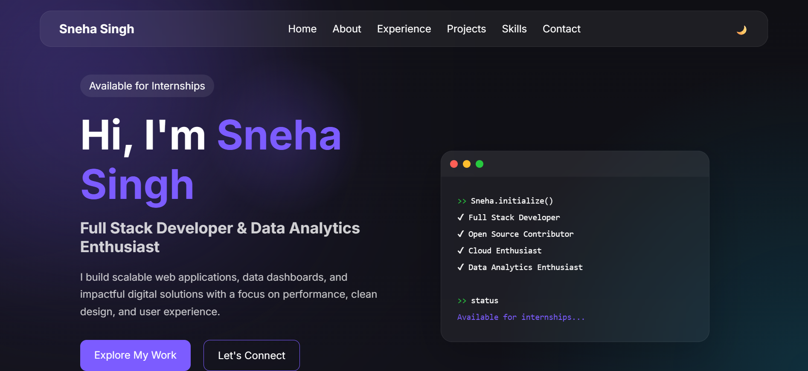

<div align="center">



<br />

# ✦ SNEHA SINGH

### Developer by logic. Creative by nature.

<p>
  A little corner of the internet where my code, projects, skills,
  and personality come together.
</p>

<p>
  <a href="https://myselfsneha.github.io/sneha-portfolio/">
    
  </a>
  <a href="https://www.linkedin.com/in/singh--sneha/">
    
  </a>
  <a href="https://github.com/myselfsneha">
    
  </a>
</p>

<p>
  
  
  
</p>

</div>

---

<div align="center">

## ✨ Not just a portfolio. A little bit of me.

*My work, my learning journey, and the things I'm building along the way.*

</div>

I'm Sneha Singh, a Computer Science postgraduate and developer interested in building useful, interactive, and thoughtfully designed digital experiences.

This portfolio brings together my technical skills, projects, education, interests, and ways to connect with me — all in one place.

I wanted something that feels like more than a résumé on a webpage: **a space that introduces the person behind the code.**

---

## 🪄 What's inside?

<table>
  <tr>
    <td width="50%" valign="top">
      <h3>👋 About Me</h3>
      A personal introduction covering my background, education, passions, and interests.
    </td>
    <td width="50%" valign="top">
      <h3>💻 Projects</h3>
      A showcase of personal and collaborative projects, reflecting what I've learned and built.
    </td>
  </tr>
  <tr>
    <td width="50%" valign="top">
      <h3>🧠 Skills</h3>
      A snapshot of my technical interests and development toolkit.
    </td>
    <td width="50%" valign="top">
      <h3>🌗 Dark Mode</h3>
      A theme toggle for switching between light and dark appearances.
    </td>
  </tr>
  <tr>
    <td width="50%" valign="top">
      <h3>🎞️ Interactive Design</h3>
      CSS animations, hover effects, and interactive elements that bring the interface to life.
    </td>
    <td width="50%" valign="top">
      <h3>📬 Let's Connect</h3>
      Contact functionality and social links to make getting in touch easier.
    </td>
  </tr>
</table>

---

## 🎨 The design philosophy

A personal portfolio should be easy to explore without feeling lifeless.

This project brings together:

- **Clean layouts** that keep content readable.
- **Colorful visual elements** that give the interface personality.
- **Interactive details** that make navigation feel engaging.
- **Responsive styling** for desktop, tablet, and mobile screens.
- **Light and dark themes** for different viewing preferences.

The goal is simple: make the experience feel personal while keeping the work at the center.

---

## 🧰 Under the hood

<div align="center">

### The toolkit


</div>

<table>
  <thead>
    <tr>
      <th>Category</th>
      <th>Technology</th>
      <th>Purpose</th>
    </tr>
  </thead>
  <tbody>
    <tr>
      <td><strong>Structure</strong></td>
      <td>HTML5</td>
      <td>Page structure and content.</td>
    </tr>
    <tr>
      <td><strong>Presentation</strong></td>
      <td>CSS3</td>
      <td>Layouts, responsive styling, animations, and hover effects.</td>
    </tr>
    <tr>
      <td><strong>Interaction</strong></td>
      <td>JavaScript</td>
      <td>Interactive behavior and interface functionality.</td>
    </tr>
    <tr>
      <td><strong>Design tools</strong></td>
      <td>Figma and Canva</td>
      <td>Design and visual-content tools.</td>
    </tr>
    <tr>
      <td><strong>Deployment</strong></td>
      <td>GitHub Pages</td>
      <td>Hosting the live portfolio.</td>
    </tr>
  </tbody>
</table>

---

## 🗂️ Project structure

```text
sneha-portfolio/
│
├── assets/             # Portfolio assets
├── index.html          # Main portfolio page
├── style.css           # Styling and responsive presentation
├── script.js           # Interactive functionality
├── resume.html         # Online résumé page
├── SnehaSinghCV.pdf    # Résumé PDF
├── portfolio.png       # Portfolio preview image
├── README.md           # Project documentation
└── LICENSE             # MIT License
```

---

## 🚀 Run it locally

Want to explore the code or experiment with the design?

### 1. Clone the repository

```bash
git clone https://github.com/myselfsneha/sneha-portfolio.git
```

### 2. Enter the project directory

```bash
cd sneha-portfolio
```

### 3. Open the portfolio

Open `index.html` in your browser.

No framework installation or build process is required for the basic HTML, CSS, and JavaScript setup.

---

## 🌐 Live on the internet

<div align="center">

### Curious to see it in action?

<p>
  <a href="https://myselfsneha.github.io/sneha-portfolio/">
    
  </a>
</p>

<p>
  Hosted with GitHub Pages and available to explore online.
</p>

</div>

---

## 🛣️ The journey so far

This portfolio has grown through iterations, interface refinements, and improvements to its presentation.

The repository includes updates to the main portfolio, visual effects, résumé integration, and the preview shown in this README.

Rather than treating a portfolio as something that never changes, I see it as an evolving snapshot of what I'm learning, creating, and becoming as a developer.

---

## 🤝 Contributions

This is my personal portfolio project, but constructive feedback and ideas are always welcome.

If you spot an issue or have a suggestion, feel free to open an issue or submit a pull request.

---

## 📜 License

This project is licensed under the **MIT License**. See the [`LICENSE`](LICENSE) file for details.

---

<div align="center">

## 💌 Let's connect!

<p>
  Interested in my work, want to collaborate, or simply want to say hello?
</p>

<a href="https://www.linkedin.com/in/singh--sneha/">
  
</a>
<a href="https://github.com/myselfsneha">
  
</a>
<a href="https://myselfsneha.github.io/sneha-portfolio/">
  
</a>

<br />
<br />

**Made with code, curiosity, and a little creativity.** 🫶🏻

<sub>© Sneha Singh · Personal Portfolio</sub>

</div>
