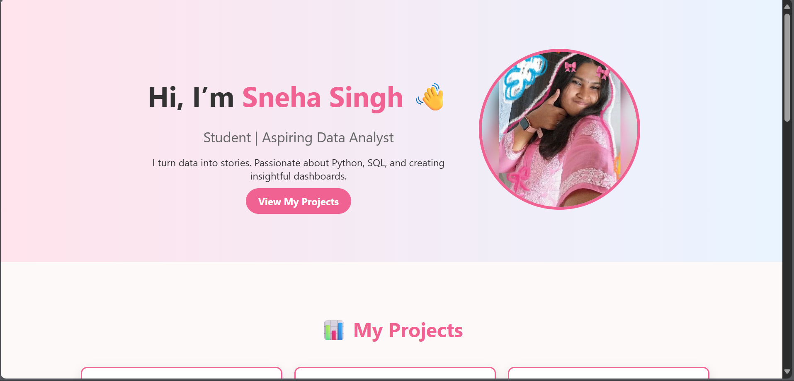

# ✳ SNEHA SINGH — DEVELOPER, DATA & A LITTLE CHAOS

<p align="center">
  
</p>

<p align="center">
  <strong>Developer by logic. Creative by nature. Forever a work in progress.</strong>
  <br>
  A little corner of the internet where code meets curiosity, projects meet personality, and learning never really stops.
</p>

<p align="center">
  <a href="https://myselfsneha.github.io/sneha-portfolio/">✦ Explore Portfolio</a> ·
  <a href="https://www.linkedin.com/in/singh--sneha/">LinkedIn ↗</a> ·
  <a href="https://github.com/myselfsneha">GitHub ↗</a> ·
  <a href="SnehaSinghCV.pdf">Resume ↗</a>
</p>

<p align="center">
  
  
  
  
</p>

---

## 01 / THE IDEA BEHIND IT

This isn't just a résumé wearing a website costume. ✳

I'm **Sneha Singh**, an M.Sc. Computer Science student at Devi Ahilya Vishwavidyalaya (DAVV), Indore. I'm interested in full-stack development, data analytics, and AI/ML — basically, I enjoy figuring out how things work and then trying to build something useful with what I learn.

I wanted my portfolio to do more than list technologies. It should give people a glimpse of the person behind the projects: what I'm learning, what I've built, and where I'm heading next.

So this repository brings together my work, technical toolkit, experience, and ways to connect, with a design that leaves room for a little personality.

**The philosophy:** useful content first, personality everywhere, and absolutely no need to look like every other developer portfolio.

## 02 / WHAT'S INSIDE THE BOX?

| ✳ Feature | What's there |
|---|---|
| Personal introduction | Background, education, interests, and current direction |
| Project archive | Personal and collaborative development projects plus data dashboards |
| Experience timeline | Professional, community, open-source, and training experiences |
| Technical toolkit | Programming, frontend, backend, databases, analytics, and tools |
| Light and dark themes | A choice of visual atmosphere |
| Interactive details | Hover states, animations, navigation, and project filtering |
| Résumé page | A dedicated page for viewing and accessing the PDF résumé |
| Contact section | Social links and a way to prepare an email message |
| Responsive layout | A layout designed to adapt to desktop, tablet, and mobile screens |

## 03 / THE BUILD ARCHIVE

A few different corners of my developer brain, all in one place.

### ◇ Diamond Square

A society management system focused on resident management, complaints, visitors, maintenance billing, and notices.

**Stack:** React · Node.js · PostgreSQL · Supabase

[View repository](https://github.com/myselfsneha/diamond-square) · [Live demo](https://diamond-square.vercel.app/)

### ✳ EduNexus

A collaborative learning ecosystem designed around student, faculty, and administrator workflows, with authentication, role-based access, and dashboards.

**Stack:** React · Node.js · Express · MySQL

[View repository](https://github.com/myselfsneha/EduNexus) · [Live demo](https://edu-nexus-lilac.vercel.app/)

### ▥ Blinkit Sales Dashboard

An interactive business intelligence project exploring sales performance, inventory patterns, key metrics, and customer insights.

**Stack:** Power BI · Excel

[View repository](https://github.com/myselfsneha/Blinkit-Sales-Analysis-Dashboard)

### 🚦 Road Accident Analysis

A data dashboard exploring accident severity, weather conditions, casualties, and trends within the dataset.

**Stack:** Excel · Data Analysis · Dashboard Design

[View repository](https://github.com/myselfsneha/Road-Accident-Analysis-Dashboard)

### ✿ Wedding Crunchers

An exploratory data analysis project investigating wedding costs, seasonal trends, and geographical patterns.

**Stack:** Python · Pandas · GeoPandas

[View repository](https://github.com/myselfsneha/Wedding-Crunchers-Data-Analysis)

### 🖥️ The Portfolio Itself

A hand-built personal website that brings together my projects, experience, skills, and contact information.

**Stack:** HTML · CSS · JavaScript

[View repository](https://github.com/myselfsneha/sneha-portfolio) · [Visit website](https://myselfsneha.github.io/sneha-portfolio/)

## 04 / THE TOOLBOX

<table>
  <tr>
    <td><strong>Programming</strong></td>
    <td>Python, Java, JavaScript, SQL</td>
  </tr>
  <tr>
    <td><strong>Frontend</strong></td>
    <td>HTML5, CSS3, React.js</td>
  </tr>
  <tr>
    <td><strong>Backend</strong></td>
    <td>Node.js, Express.js, REST APIs</td>
  </tr>
  <tr>
    <td><strong>Databases</strong></td>
    <td>MySQL, PostgreSQL, Supabase</td>
  </tr>
  <tr>
    <td><strong>Data & Analytics</strong></td>
    <td>Power BI, Excel, Pandas, NumPy</td>
  </tr>
  <tr>
    <td><strong>Tools</strong></td>
    <td>Git, GitHub, VS Code, Jupyter Notebook</td>
  </tr>
  <tr>
    <td><strong>Deployment</strong></td>
    <td>Vercel, Render, Netlify, GitHub Pages</td>
  </tr>
  <tr>
    <td><strong>AI & ML</strong></td>
    <td>Machine learning concepts, prompt engineering, and AI tools</td>
  </tr>
  <tr>
    <td><strong>Design</strong></td>
    <td>Figma, Canva</td>
  </tr>
</table>

## 05 / HOW IT'S PUT TOGETHER

No framework maze. No complicated build pipeline. Just the fundamentals working together.

- **HTML5** structures the pages and their content.
- **CSS3** handles the layout, visual identity, responsive styling, transitions, and animations.
- **JavaScript** adds interactive behavior to the interface.
- **Git and GitHub** support version control and repository hosting.
- **GitHub Pages** publishes the portfolio online.

### Repository map

```text
sneha-portfolio/
├── assets/
│   ├── accident.png
│   ├── blinkit.png
│   ├── portfolio.png
│   ├── rohan.png
│   ├── sneha.jpg
│   └── wedding.png
├── index.html
├── style.css
├── script.js
├── resume.html
├── SnehaSinghCV.pdf
├── portfolio.png
├── README.md
└── LICENSE
```

## 06 / RUN IT LOCALLY

Want to explore the code or experiment with the design? Go for it.

**1. Clone the repository**

```bash
git clone https://github.com/myselfsneha/sneha-portfolio.git
```

**2. Enter the project directory**

```bash
cd sneha-portfolio
```

**3. Open the website**

Open `index.html` in your browser, or use the Live Server extension in VS Code for a local development preview.

That's it. The portfolio uses plain HTML, CSS, and JavaScript, so there is no framework installation or build command required.

## 07 / THE DESIGN NOTES

The visual direction is where the practical and personal sides of the project meet.

- **Expressive, not cluttered:** visual personality without making the content hard to read.
- **Playful details:** small labels, unexpected accents, and developer-inspired elements.
- **Projects in focus:** the work should be easy to discover and explore.
- **Responsive by design:** the layout should adapt to different screen sizes.
- **Theme flexibility:** light and dark appearances for different preferences.
- **Room to evolve:** the website can change as my skills and projects grow.

A portfolio isn't a finished product that gets locked away. It's a snapshot of the journey, and the journey keeps going.

## 08 / THE JOURNEY CONTINUES

This repository has evolved through iterations, interface refinements, résumé integration, and updates to the way my work is presented.

The goal isn't to make the website look like I know everything already. It's to document what I'm building, share what I'm learning, and make it easier for people to discover my work.

There will be more things to build, more skills to pick up, and more ideas that start with *"wait, what if I tried this?"*

That's the fun part.

## 09 / FEEDBACK & CONTRIBUTIONS

This is my personal portfolio, but thoughtful feedback and suggestions are always welcome.

If you spot an issue or have an idea for improvement, feel free to open an issue or submit a pull request.

## 10 / FIND ME AROUND THE INTERNET

<p align="center">
  <a href="https://myselfsneha.github.io/sneha-portfolio/"><strong>✳ Portfolio</strong></a> ·
  <a href="https://github.com/myselfsneha"><strong>⌘ GitHub</strong></a> ·
  <a href="https://www.linkedin.com/in/singh--sneha/"><strong>↗ LinkedIn</strong></a> ·
  <a href="mailto:snehaasingh.2409@gmail.com"><strong>✉ Email</strong></a>
</p>

If you've made it this far, thank you for stopping by. Have a look around, explore the projects, and say hello if something catches your eye.

## LICENSE

This project is licensed under the MIT License. See [LICENSE](LICENSE) for details.

---

<p align="center">
  <strong>Made with code, curiosity, and a little chaos. 🫶🏻</strong>
  <br>
  © Sneha Singh
</p>
